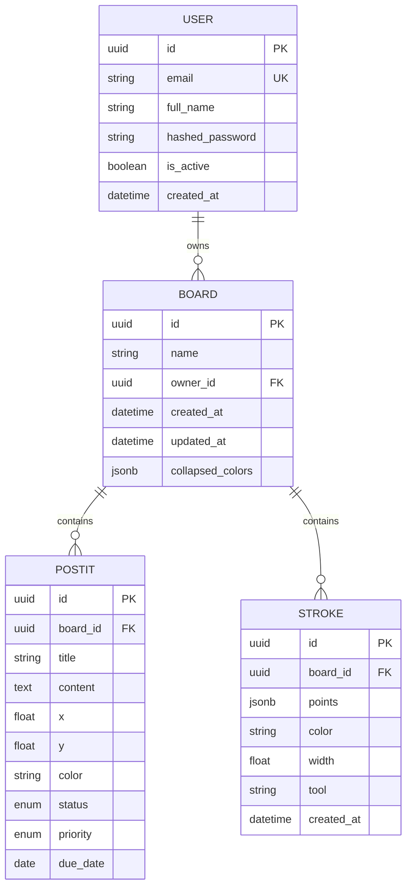

# ERD — Vibeboard

Dit ERD is afgeleid van `backend/app/models.py` en de Alembic-migraties. Het toont de vier entiteiten en de relaties die samen het whiteboard, de Kanban-weergave en de tekeningen opslaan.

## Relaties en regels

- Een **User** bezit nul of meer **Boards** (`Board.owner_id` → `User.id`, `ON DELETE CASCADE`).
- Een **Board** bevat nul of meer **PostIts** en **Strokes** (`board_id` → `Board.id`, `ON DELETE CASCADE`).
- `PostIt.status` is een enum met `TODO`, `IN_PROGRESS` en `DONE`; `PostIt.priority` is `LOW`, `MEDIUM` of `HIGH` (optioneel).
- `PostIt.x` en `PostIt.y` bewaren de positie in boardcoördinaten; `color` bewaart de kleur uit het vaste palet.
- `Stroke.points` en `Board.collapsed_colors` worden als PostgreSQL `JSONB` opgeslagen.
- De cascade-regels zijn expliciet vastgelegd in migratie `1a31ce608336_add_cascade_delete_relationships.py`.
